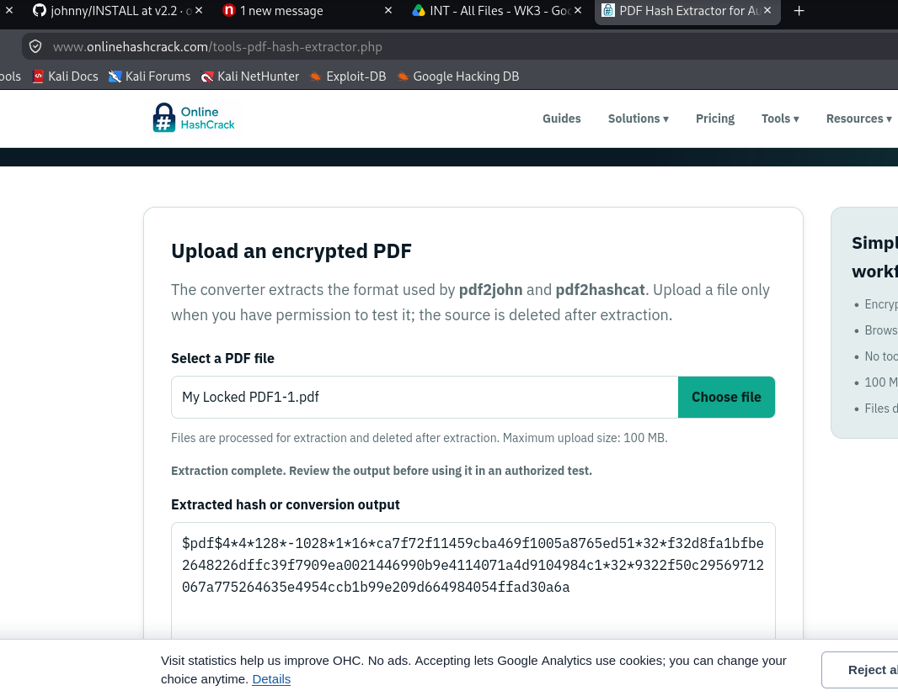
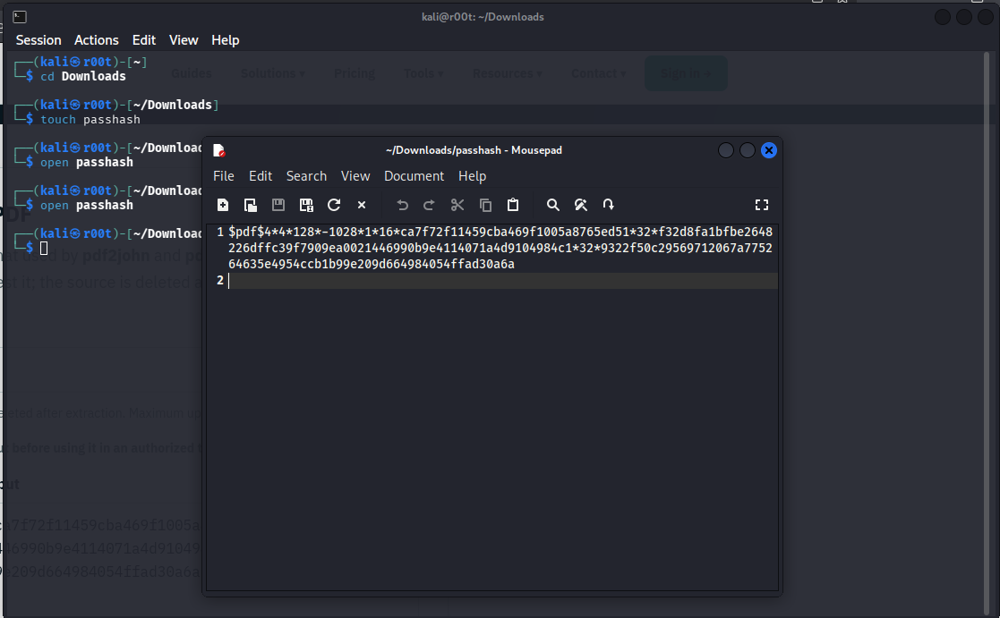
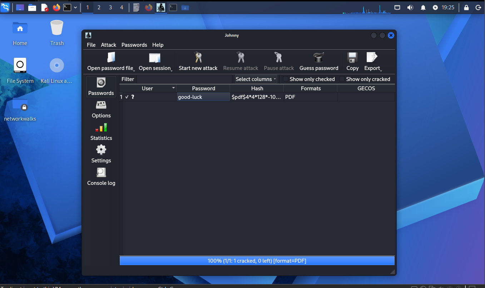
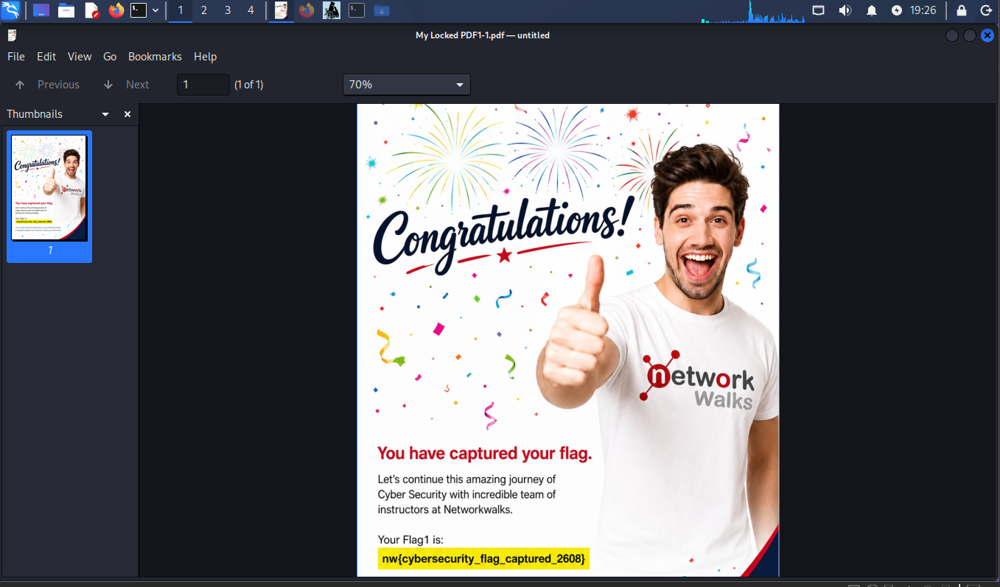
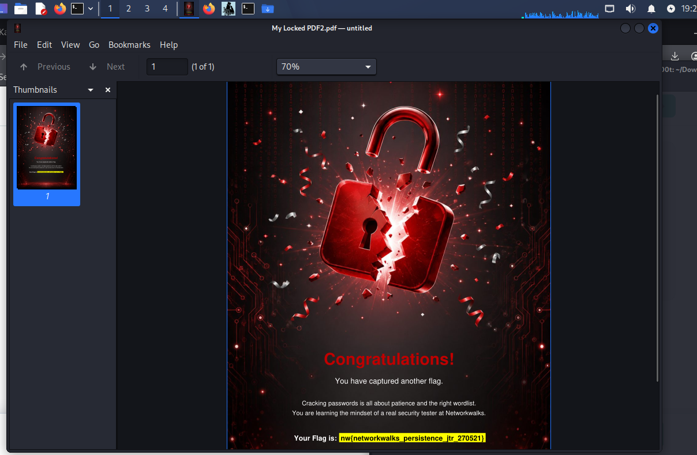
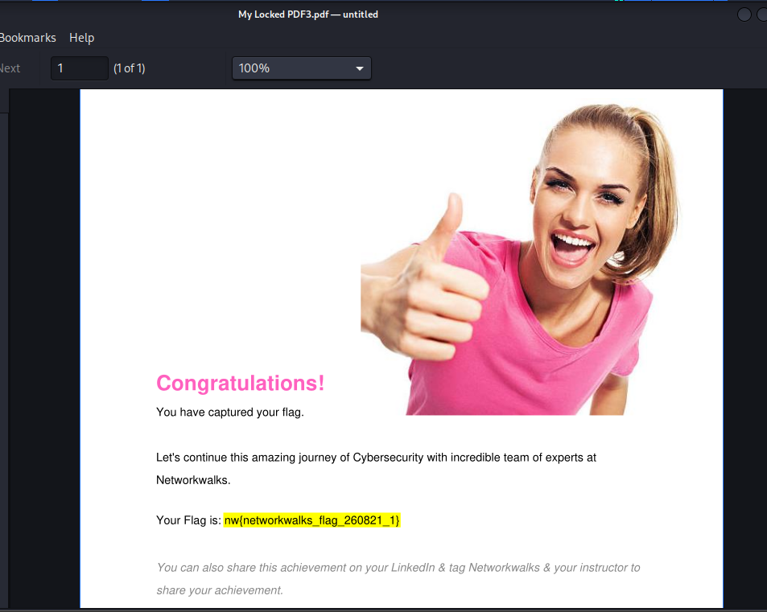
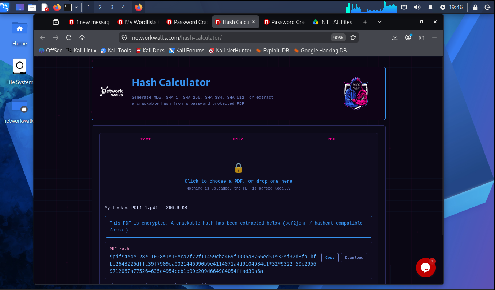
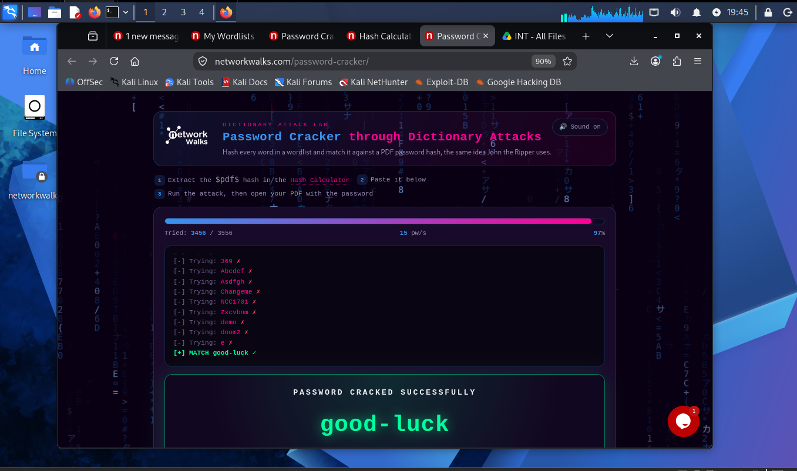
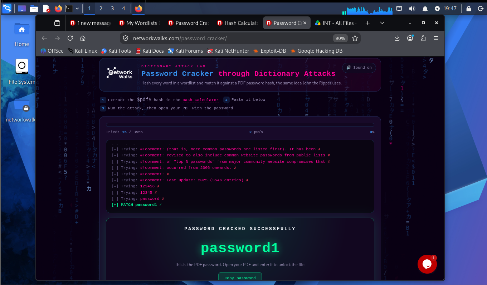
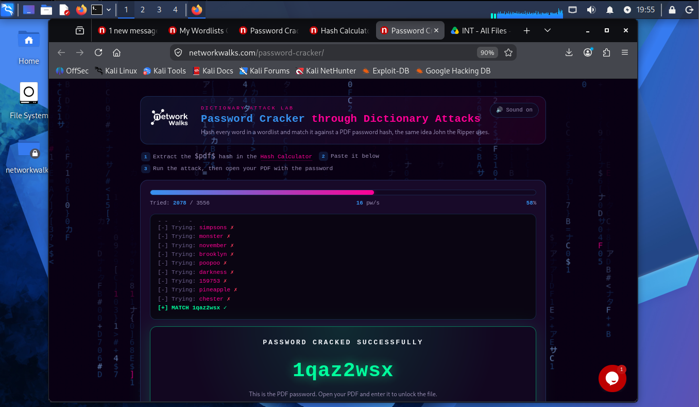

<div align="center">

# PASSWORD AUDITING & RECOVERY REPORT

## WEEK 3 | PROJECT MODULE

# PASSWORD CRACKING
### USING JOHN THE RIPPER & NETWORKWALKS WEB-BASED TOOLS

<p>
  
  
  
  
  
  
</p>

**A practical report documenting password-protected PDF recovery using John the Ripper and NetworkWalks' browser-based tools.**

</div>

---

## 📌 Project Overview

| Field | Details |
|---|---|
| **Project** | Week 3 – Password Cracking |
| **Project Title** | PDF Password Cracking Using John the Ripper & NetworkWalks Web-Based Tools |
| **Intern Name** | S Bhanu Prakash |
| **Program** | NetworkWalks Cybersecurity Internship |
| **Modules Completed** | Module 1 – John the Ripper (Johnny GUI) · Module 2 – NetworkWalks Web Tools |
| **Target** | Password-protected training PDFs provided by NetworkWalks |
| **Operating System** | Kali Linux (Module 1) · Web Browser (Module 2) |
| **Phase Covered** | Password Auditing & Recovery |

This repository documents my completed **Week 3** project from the NetworkWalks Cybersecurity Internship, focused on password auditing and recovery of password-protected PDF documents through dictionary attacks.

The practical work is split into two modules:

- **Module 1 – John the Ripper (JTR):** extracting a PDF's password hash, loading it into Johnny GUI, running a dictionary attack, and recovering the password in Kali Linux.
- **Module 2 – NetworkWalks Web-Based Tools:** extracting the hash with the NetworkWalks Hash Calculator and recovering the password with the NetworkWalks Password Cracker, entirely in the browser.

Both modules show how weak PDF passwords can be identified through dictionary-based auditing.

## 🎯 Objectives

- Understand how password-protected PDF documents are secured.
- Learn how PDF password hashes are extracted for auditing.
- Understand the role of wordlists in dictionary attacks.
- Perform password recovery using John the Ripper.
- Explore Johnny GUI as a graphical front end for JTR.
- Use NetworkWalks' browser-based password auditing tools.
- Track cracking progress and confirm successful password matches.
- Verify every recovered password by opening the original PDF.
- Reinforce the importance of strong passwords and secure document protection.

---

# 🧩 MODULE 1 – PDF Password Cracking Using John the Ripper

## 1. Introduction

John the Ripper is an open-source password auditing and recovery tool. It supports a range of password hash formats and performs dictionary attacks by testing candidate passwords from a wordlist against an extracted hash. For this module, I used JTR through its graphical front end, **Johnny**, in Kali Linux.

## 2. Tools Used

| Tool | Purpose |
|---|---|
| **Kali Linux** | Testing environment |
| **John the Ripper** | Password auditing and recovery engine |
| **Johnny GUI** | Graphical interface for JTR |
| **PDF Hash Extractor** | Extracts the PDF's password hash into a John-compatible format |
| **Wordlist** | Supplies password candidates for the dictionary attack |
| **PDF Viewer** | Verifies the recovered password |

## 3. Methodology

I repeated the same workflow for all three protected training PDFs (`My Locked PDF1.pdf`, `My Locked PDF2.pdf`, `My Locked PDF3.pdf`).

**Step 1 – Obtain the protected PDF**
Downloaded each password-protected training PDF provided for the exercise.

**Step 2 – Extract the PDF hash**
Used an online PDF hash extractor (pdf2john/pdf2hashcat-compatible) to convert each encrypted PDF into a crackable `$pdf$` hash.

**Step 3 – Save the extracted hash**
Saved each extracted hash into a text file (`passhash`) in `~/Downloads` for processing by John the Ripper.

**Step 4 – Launch Johnny GUI**
Opened Johnny in Kali Linux and loaded each saved hash file as a new password file.

**Step 5 – Perform the dictionary attack**
Started the attack using a wordlist for each hash. Johnny worked through the candidate passwords and flagged a match in every case.

**Step 6 – Verify the recovered password**
Opened each original protected PDF using its recovered password and confirmed the document unlocked successfully.

## 4. Result

<details>
<summary><b>PDF 1 – Password Recovery Result</b></summary>

- **PDF:** `My Locked PDF1.pdf`
- **Cracking interface:** Johnny GUI
- **Recovered password:** `good-luck`
- **Status:** ✅ Successfully recovered
- **Verification:** Original PDF opened successfully

**Captured Flag:**
```text
nw{cybersecurity_flag_captured_2608}
```
</details>

<details>
<summary><b>PDF 2 – Password Recovery Result</b></summary>

- **PDF:** `My Locked PDF2.pdf`
- **Cracking interface:** Johnny GUI
- **Recovered password:** `password1`
- **Status:** ✅ Successfully recovered
- **Verification:** Original PDF opened successfully

**Captured Flag:**
```text
nw{networkwalks_persistence_jtr_270521}
```
</details>

<details>
<summary><b>PDF 3 – Password Recovery Result</b></summary>

- **PDF:** `My Locked PDF3.pdf`
- **Cracking interface:** Johnny GUI
- **Recovered password:** `1qaz2wsx`
- **Status:** ✅ Successfully recovered
- **Verification:** Original PDF opened successfully

**Captured Flag:**
```text
nw{networkwalks_flag_260821_1}
```
</details>

**Screenshot / Evidence:**








---

# 🌐 MODULE 2 – NetworkWalks Web-Based Password Cracking Tools

## 1. Introduction

The second module used NetworkWalks' own browser-based cybersecurity tools to repeat the exercise without any local tooling. It combines two tools:

1. **NetworkWalks Hash Calculator** – extracts password hashes from protected PDF documents, entirely client-side.
2. **NetworkWalks Password Cracker** – runs a dictionary attack against the extracted hash, the same underlying idea as John the Ripper.

## 2. Tools Used

| Tool | Purpose |
|---|---|
| **NetworkWalks Hash Calculator** | PDF hash extraction |
| **NetworkWalks Password Cracker** | Dictionary-based password recovery |
| **Web Browser** | Accesses the online tools |
| **PDF Viewer** | Verifies recovered passwords |

**Official tools used:**
- [NetworkWalks Hash Calculator](https://networkwalks.com/hash-calculator/)
- [NetworkWalks Password Cracker](https://networkwalks.com/password-cracker/)

## 3. Methodology

**Step 1 – Select the protected PDF**
Opened the NetworkWalks Hash Calculator and selected the **PDF** tab.

**Step 2 – Extract the PDF hash**
Uploaded the protected PDF. The calculator parsed it locally in the browser and returned a crackable hash in `$pdf$` format (pdf2john/hashcat-compatible).

**Step 3 – Copy the extracted hash**
Copied the generated hash from the Hash Calculator output box.

**Step 4 – Open the Password Cracker**
Navigated to the NetworkWalks Password Cracker page.

**Step 5 – Submit the extracted hash**
Pasted the hash into the cracker's input field.

**Step 6 – Run the dictionary attack**
Started the attack against the built-in wordlist. The interface displayed live progress: candidates tried, total wordlist size, percentage complete, attempts per second, and the current candidate being tested — until a match was found.

**Step 7 – Verify the recovered password**
Entered the recovered password into the original PDF and confirmed it opened successfully.

**Screenshot / Evidence:**






## 4. Results – PDF Password Recovery

Three separate PDF documents were successfully recovered across the two modules.

### PDF 1 – My Locked PDF1.pdf

| Parameter | Result |
|---|---|
| Extracted hash | ✅ Successful |
| Recovered password | `good-luck` |
| Cracking status | ✅ Successful |
| PDF verification | ✅ Successful |

**Captured Flag:**
```text
nw{cybersecurity_flag_captured_2608}
```


### PDF 2 – My Locked PDF2.pdf

| Parameter | Result |
|---|---|
| Extracted hash | ✅ Successful |
| Recovered password | `password1` |
| Cracking status | ✅ Successful |
| PDF verification | ✅ Successful |

**Captured Flag:**
```text
nw{networkwalks_persistence_jtr_270521}
```


### PDF 3 – My Locked PDF3.pdf

| Parameter | Result |
|---|---|
| Extracted hash | ✅ Successful |
| Recovered password | `1qaz2wsx` |
| Cracking status | ✅ Successful |
| PDF verification | ✅ Successful |

**Captured Flag:**
```text
nw{networkwalks_flag_260821_1}
```


---

# 🏆 RESULTS – ALL THREE PDF FILES

| PDF Document | Recovered Password | Captured Flag |
|---|---|---|
| My Locked PDF1.pdf | `good-luck` | `nw{cybersecurity_flag_captured_2608}` |
| My Locked PDF2.pdf | `password1` | `nw{networkwalks_persistence_jtr_270521}` |
| My Locked PDF3.pdf | `1qaz2wsx` | `nw{networkwalks_flag_260821_1}` |

<details>
<summary><b>View all three extracted PDF hashes</b></summary>

**PDF 1 – My Locked PDF1.pdf**
```text
$pdf$4*4*128*-1028*1*16*ca7f72f11459cba469f1005a8765ed51*32*f32d8fa1bfbe2648226dffc39f7909ea0021446990b9e4114071a4d9104984c1*32*9322f50c29569712067a775264635e4954ccb1b99e209d664984054ffad30a6a
```

**PDF 2 – My Locked PDF2.pdf**
```text
$pdf$4*4*128*-1028*1*16*0853f2cde0ef15b1c0f93ed229d3b1ad*32*8f13ce5aa39ad974364d36a057da76790021446990b9e4114071a4d9104984c1*32*ceecdac74b19b5a62688d3b3524e1374c955cbb9cc3c45316494d9446ef81af1
```

**PDF 3 – My Locked PDF3.pdf**
```text
$pdf$4*4*128*-1028*1*16*34eb542eff4e1b0b32d25ce15a9a7281*32*b77872bfc9a24fb2f845066283a8fc1b0021446990b9e4114071a4d9104984c1*32*e7572256e4b552cd57988f5134214b91920d94d7a6bf550ea94a2995c7f2ab02
```

</details>

## ⚖️ Comparison of Both Modules

| Feature | Module 1 – JTR | Module 2 – Web Tools |
|---|---|---|
| PDFs cracked | 3 (PDF1, PDF2, PDF3) | 3 (PDF1, PDF2, PDF3) |
| Environment | Kali Linux | Web browser |
| Hash extraction | Online PDF hash extractor | NetworkWalks Hash Calculator |
| Password recovery | John the Ripper | NetworkWalks Password Cracker |
| Interface | Johnny GUI | Web interface |
| Wordlist | Local wordlist | Built-in wordlist |
| Password verification | PDF Viewer | PDF Viewer |

## 📚 Key Concepts Learned

| Concept | Learning |
|---|---|
| Password Hash | How password verification relies on comparing hashes, not plaintext |
| PDF Hash Extraction | Converting an encrypted PDF's protection data into a crackable hash format |
| Dictionary Attack | Testing candidate passwords from a wordlist against a target hash |
| Wordlist | A curated collection of likely/common passwords used as attack input |
| John the Ripper | An open-source password auditing and recovery tool |
| Johnny GUI | A graphical interface that makes JTR easier to operate and monitor |
| Hash Matching | Identifying the candidate whose hash matches the target hash |
| PDF Encryption | How PDF password protection is implemented and where its weaknesses lie |

## 🔐 Security Recommendations

Based on these exercises, the following practices help defend against this class of attack:

- Use long, unique passwords for protected documents.
- Avoid common passwords and predictable patterns (e.g. `password1`, `1qaz2wsx`).
- Never reuse passwords across different documents or accounts.
- Use a password manager to generate and store strong, random passwords.
- Choose modern, strong encryption settings when protecting PDFs.
- Keep sensitive documents and their passwords away from unauthorized access.

---

# 🏁 Conclusion

I successfully completed both modules of the Week 3 NetworkWalks cybersecurity project. In Module 1, I gained hands-on experience extracting PDF password hashes and using John the Ripper with Johnny GUI to recover a password in Kali Linux. In Module 2, I repeated the workflow entirely in the browser using NetworkWalks' Hash Calculator and Password Cracker.

All three protected PDF documents were successfully recovered and verified by opening the original files. This project reinforced the practical workflow behind PDF password recovery — hash extraction, wordlist-based attacks, and the real-world importance of strong password security.

---

## ⚠️ Ethical Disclaimer

This project was performed strictly for educational purposes as part of the NetworkWalks Cybersecurity Internship. All password auditing and recovery activity was carried out on designated training documents provided for the exercise.

Password-cracking tools should only be used on files and systems you own or have explicit authorization to assess.

---

## 🛠️ Technologies & Tools

- Kali Linux
- John the Ripper
- Johnny GUI
- NetworkWalks Hash Calculator
- NetworkWalks Password Cracker
- PDF Hash Extraction
- Dictionary Attacks
- Wordlists

---

## 👨‍💻 Author

**S Bhanu Prakash**
B.Tech – Computer Science and Engineering
Cybersecurity Student | NetworkWalks Cybersecurity Intern(B084N)

GitHub: [https://github.com/sbhanuprakash-sbp](https://github.com/sbhanuprakash-sbp)
LinkedIn: [https://www.linkedin.com/in/s-bhanu-prakash/](https://www.linkedin.com/in/s-bhanu-prakash/)

---

## 📌 Project Information

**Program Name:** Cybersecurity at Networkwalks | **Week:** 03 | **Project:** Password Cracking | **Repository:** GitHub

</div>
